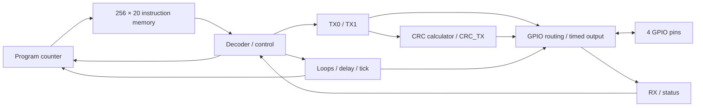

# Programmable Protocol Emulator

A small SystemVerilog processor for generating GPIO protocol waveforms from assembly programs. This repository is a curated **v0.9 work-in-progress snapshot**.

- 20-bit instructions, branches, hardware loops and programmable delays.
- Two transmit shift registers, four GPIOs, open-drain and timed output.
- Configurable 1–32-bit CRC calculation and CRC transmission.
- Python assembler with CRC and timing examples.



## Try the assembler

Python 3.10+, no extra packages. Run from the repository root:

```sh
python -m assembler examples/crc_tx.asm -o examples/crc_tx.bin --pad-to 256
```

Tests and testbenches are omitted; no full v0.9 RTL regression is claimed.

## Browse

| Folder | Contents |
| --- | --- |
| [rtl](rtl) | Original v0.9 RTL, unchanged |
| [assembler](assembler) / [examples](examples) | Assembler, CRC/tick examples, CAN sketch and inherited I2C image |
| [docs](docs/ISA.md) | Instruction set and [CRC register map](docs/CRC.md) |
| [timing](timing/README.md) | Pre-route STA report, constraints, mapped netlist and area data |

## Status

Arbitration/event handling and its configuration are unfinished; the original top level does **not** compile as-is. CRC output is fixed to GPIO0, RX readout is incomplete, and bit stuffing/NRZI are future work. The timing report covers a documented synthesis model that excludes unfinished arbitration, not the complete RTL. No place-and-route or timing closure is claimed.

`rtl/imem.sv` retains its original `i2c.bin` working-directory lookup; the image is in `examples/`. The assembler still calls the inherited instruction set `v0.8`.
